# Timeout and Menopause Supplement Video Research

[](https://deepwiki.com/UoA-eResearch/timeout)
[](https://github.com/UoA-eResearch/timeout/actions/workflows/googlesearch.yml)
[](https://github.com/UoA-eResearch/timeout/actions/workflows/analyze_data.yml)

This repository collects and analyzes short-form videos about parenting timeout strategies and menopause-related supplements using automated Google Search scraping and AI-powered video analysis.

## Overview

The project consists of two main components:

1. **Google Search Scraper** (`src/run_googlesearch.py`) - Automatically scrapes Google search results for short videos
2. **Video Analysis** (`src/batch_LLM.py`) - Processes videos using a large language model to extract structured information

## Installation

### Basic Requirements

```bash
uv pip install -r requirements.txt
```

### For Google Search Scraping

```bash
pip install -r requirements-googlesearch.txt
```

Required Python packages:
- pandas
- tqdm
- selenium
- undetected-chromedriver

System packages (for Tor support):
- tor
- torsocks
- chromium/chrome browser

## Usage

### 1. Google Search Scraper (`src/run_googlesearch.py`)

This script scrapes Google search results for short videos related to:
- **Timeout dataset**: see `data/timeout_search_terms.txt`
- **Supplements dataset**: see `data/supplements_search_terms.txt`
- **Distress dataset**: how young people in New Zealand talk about psychological distress; see `data/distress_search_terms.txt`. Searches are localised to NZ (Google `gl=nz`)

Each dataset's search terms live in `data/{dataset}_search_terms.txt`, one per line; to add a dataset, create that file and add its name to `DATASETS` in `src/run_googlesearch.py` (and to `REGIONS` to localise its results to a country).

#### Run the scraper locally:

```bash
# Normal execution (scrapes both datasets)
python3 src/run_googlesearch.py

# Scrape only one dataset
python3 src/run_googlesearch.py --dataset timeout
python3 src/run_googlesearch.py --dataset supplements
python3 src/run_googlesearch.py --dataset distress

# With Tor (if IP blocked)
torsocks python3 src/run_googlesearch.py

# Or use the --use-tor flag
python3 src/run_googlesearch.py --use-tor
```

#### How it works:

1. Searches the Google "Short videos" section for the specified search terms
2. Scrolls to load more results and clicks "More results" button
3. Scrapes video metadata: link, duration, title, source, author
   - `https://www.google.com/goto?url=...` redirect links are resolved to the destination URL
   - Query parameters that don't identify the video (`hl`, `si`, `utm_*` etc.) are stripped so duplicates match; only `v`, `story_fbid`, `fbid` and `id` are kept
   - Links are deduplicated by platform video ID, so e.g. Instagram `/p/ID/` and `/reel/ID/` or YouTube `/shorts/ID` and `/watch?v=ID` count once
4. Combines results with previous data
5. Filters to include only Instagram, TikTok, YouTube, and Facebook videos
6. Saves results to CSV and text files

#### Output files:

**Timeout dataset:**
- `data/timeout.csv` - Full results with columns: link, duration, title, source, author
- `data/timeout_links.txt` - Just the links, one per line

**Supplements dataset:**
- `data/supplements.csv` - Full results with columns: link, duration, title, source, author
- `data/supplements_links.txt` - Just the links, one per line

**Distress dataset:**
- `data/distress.csv` - Full results with columns: link, duration, title, source, author
- `data/distress_links.txt` - Just the links, one per line

#### IP Blocking Protection:

The scraper includes automatic protection against IP blocking:
1. Waits a randomised `--delay` (default ~30s) between searches
2. Solves Google's reCAPTCHA when it appears, then reloads the search
3. Retries a search that returns no results (`--retries`, default 3 attempts) with a fresh browser after a growing wait (1, 2, 4... minutes), saving results after every search term so progress isn't lost
4. In GitHub Actions, if a run still fails (likely due to IP blocking), automatically retries with Tor/torsocks

For a long local run that should get through every term, raise the retries and delay, e.g. `python3 src/run_googlesearch.py --dataset distress --retries 6 --delay 45`.

#### Automated Execution:

The repository includes a GitHub Actions workflow (`.github/workflows/googlesearch.yml`) that:
- Runs daily at 2 AM UTC (configurable via cron schedule)
- Can also be triggered manually via GitHub Actions UI
- Automatically commits updated CSV files back to the repository

To trigger manually:
1. Go to the "Actions" tab in GitHub
2. Select "Google Search Scraper" workflow
3. Click "Run workflow"

To change the schedule, edit the cron expression in `.github/workflows/googlesearch.yml`:
```yaml
schedule:
  - cron: '0 2 * * *'  # Daily at 2 AM UTC
```

Common cron schedules:
- `0 */6 * * *` - Every 6 hours
- `0 0 * * 0` - Weekly on Sunday at midnight
- `0 0 1 * *` - Monthly on the 1st at midnight

### 2. Downloading Videos

To download videos from the collected links, use `yt-dlp`:

```bash
# Download timeout videos
yt-dlp --download-archive timeout_archive.log --write-info-json --output "%(title).100B [%(id)s].%(ext)s" --batch-file data/timeout_links.txt --paths timeout_videos

# Download supplements videos
yt-dlp --download-archive supplements_archive.log --write-info-json --output "%(title).100B [%(id)s].%(ext)s" --batch-file data/supplements_links.txt --paths supplements_videos

# Download distress videos (preferring <=720p H.264, which keeps files small and avoids AV1, which the LLM server can't decode)
yt-dlp --download-archive distress_archive.log --write-info-json --output "%(title).100B [%(id)s].%(ext)s" -S "res:720,vcodec:h264" --batch-file data/distress_links.txt --paths distress_videos
```

This downloads:
- Video files to `{dataset}_videos/`
- Metadata JSON files (`.info.json`) with video information

### 3. Video Analysis (`src/batch_LLM.py`)

This script processes downloaded videos using the Nemotron-3-Nano-Omni-30B-A3B-Reasoning-BF16 omnimodal LLM to extract structured information.

#### Prerequisites:

- Downloaded videos (see "Downloading Videos" section above)
- GPU with sufficient VRAM (approximately 78GB required)
- The model served with vLLM's OpenAI-compatible API. The server setup used for this project (vLLM 0.33.0, the `opencv` video backend and `--trust-request-mm-kwargs`, plus Caddy and Open WebUI) is the Docker Compose file in [UoA-eResearch/nemotron_3_nano_omni](https://github.com/UoA-eResearch/nemotron_3_nano_omni/blob/4673992/compose.yml) (pinned to the commit used; see [main](https://github.com/UoA-eResearch/nemotron_3_nano_omni/blob/main/compose.yml) for the latest). `batch_LLM.py` sends each video with `use_audio_in_video`, which needs `--trust-request-mm-kwargs`, and transcodes videos the server can't take (AV1, which its OpenCV decoder can't read, or over 20MB) to H.264 first. Its endpoint is set by `base_url` in `src/batch_LLM.py`

#### Run the video analysis:

```bash
# Process timeout dataset
python3 src/batch_LLM.py --dataset timeout

# Process supplements dataset
python3 src/batch_LLM.py --dataset supplements

# Process distress dataset
python3 src/batch_LLM.py --dataset distress
```

#### How it works:

1. Scans the `{dataset}_videos/` folder for video JSON metadata files
2. Skips videos that have already been processed (result file exists)
3. For each video:
   - Loads video file and metadata
   - Sends video and context to the LLM with a dataset-specific prompt
   - Extracts structured information based on the dataset
   - Saves results to `{dataset}_results/` folder as JSON files

#### Extracted Information:

**For timeout videos:**
- Video description and transcript
- Tone and language
- Whether video discusses timeout as a parenting strategy
- Parenting approach shown
- Target child age range
- Speaker's profession
- Sentiment (positive/neutral/negative toward timeout)
- Criticisms of timeout
- Alternative strategies mentioned
- Relevance to ASD, ADHD, anxiety
- Usefulness, misleading content, and quality ratings
- Personal experiences shared

**For supplements videos:**
- Video description and transcript
- Tone and language
- Supplements, vitamins, medications, and foods recommended for menopause
- Per supplement (`supplement_details`): its status category (the team's nine-category framework plus foods), product type (e.g. single ingredient, menopause formulation) and ingredient type
- The post's primary status category and product type, and the target groups its supplements are framed for (e.g. bone, hot flushes, sleep/mood) with a primary target group. These were assigned by keyword rules in `src/clean_supplements.py`; the LLM now assigns them from the whole video, and that script only parses its answers
- Active ingredients
- Symptoms or conditions addressed
- Whether targeted at menopause
- Speaker's profession
- Sentiment (positive/neutral/negative toward supplements)
- Criticisms of supplements
- Alternative strategies mentioned
- Usefulness, misleading content, and quality ratings
- Personal experiences shared

**For distress videos** (a first draft of the coding scheme, to be refined):
- Video description, transcript and on-screen text
- Screening: whether the video is about psychological distress, whether the speaker appears to be a young person, and evidence of a New Zealand connection
- Content type, speaker perspective and who is communicating (young person, health service, campaign, etc.)
- Distress experiences and their categories, quoted distress terms, and vocabulary register (clinical, everyday, slang, metaphor, te reo Māori)
- Algospeak and euphemisms (e.g. "unalive"), use of humour, and te reo Māori words
- Framing of distress, help-seeking, support sources, coping strategies and calls to action
- Public health messages, intended audience, safe messaging adherence for suicide/self-harm content, and self-disclosed risk
- Emotional tone and intensity, speaker's profession, usefulness, misleading content, and quality ratings

#### Output files:

Results are saved as JSON files in:
- `timeout_results/` - Analysis results for timeout videos
- `supplements_results/` - Analysis results for supplements videos
- `distress_results/` - Analysis results for distress videos

#### Benchmarks

Measured on one NVIDIA A100 80GB PCIe with vLLM 0.33.0 (the [compose setup](https://github.com/UoA-eResearch/nemotron_3_nano_omni/blob/4673992/compose.yml): 8 concurrent sequences, video sampled at 2 fps up to 360 frames), with `batch_LLM.py --max_workers 8`. `batch_LLM.py` prints these figures at the end of each run. Throughput is videos coded per second of wall-clock time; time per video is the wall-clock time of one video's request (including transcoding and retries), of which about 8 run at once.

| Run | Videos coded | Runtime | Throughput | Wall-clock per video | Time per video (mean / median) | Conditions |
|---|---|---|---|---|---|---|
| Distress, main pass, no thinking | 4,856 | 9 h 43 min | 0.139 videos/s | 7.2 s | — | overnight, GPU otherwise idle |
| Distress, all passes | 7,135 | 29.7 h start to finish | — | — | — | coded as videos downloaded, plus retries; GPU shared with the supplements validation runs |
| Supplements validation sample, no thinking | 197–210 per run | 50–60 min | 0.056–0.070 videos/s | 14–18 s | 86–129 s / 77–102 s | four runs; GPU shared with a distress pass |
| Supplements validation sample, `--think` | 207 | 3 h 44 min | 0.015 videos/s | 65 s | 472 s / 386 s | GPU shared with a distress pass |
| Supplements, full re-code, no thinking | 12,046 | 32 h 26 min | 0.103 videos/s | 9.7 s | 70.0 s / 48.7 s | GPU otherwise idle apart from Open WebUI use; a retry pass then coded 147 of the 207 failures in 1 h 54 min |

An average request carries about 16,000 prompt tokens (the video's frames and audio) and generates about 2,000 tokens (the JSON, including a full transcript), taking about 47 s, about three quarters of it generating. Supplements videos take longer than distress ones (0.103 vs 0.139 videos/s) because their JSON answers are longer. Thinking mode is roughly 4–5× slower. The timeout dataset hasn't been benchmarked, as its videos aren't on this machine.

### 4. Joining Results (`src/join_results.py`)

After running `batch_LLM.py`, this script merges the per-video AI result JSON files with their yt-dlp metadata and writes the combined data to the Excel files consumed by `analyze_data.py`.

#### Run join_results locally:

```bash
# Join results for all datasets
python3 src/join_results.py

# Join results for a single dataset
python3 src/join_results.py --dataset timeout
python3 src/join_results.py --dataset supplements
python3 src/join_results.py --dataset distress
```

#### Output files:

- `data/timeout_LLM_results.xlsx` - Combined timeout results
- `data/supplements_LLM_results.xlsx` - Combined supplements results
- `data/distress_LLM_results.xlsx` - Combined distress results

---

### 5. Full Pipeline (`run_pipeline.sh`)

`run_pipeline.sh` runs the entire pipeline end-to-end:

1. Downloads new videos with **yt-dlp**
2. Runs **batch_LLM.py** to analyze each video
3. Runs **join_results.py** to merge results into Excel files
4. Commits and pushes any updated data files back to the repository

#### Prerequisites

- `yt-dlp` installed and on `$PATH`
- Python environment with `requirements.txt` installed (see [Installation](#installation))
- GPU with ~78 GB VRAM for the LLM step (can be skipped if results already exist)
- Git credentials configured (or set `GIT_USER_NAME` / `GIT_USER_EMAIL` environment variables)

#### Run the pipeline

```bash
# Process all datasets
./run_pipeline.sh

# Process a single dataset
./run_pipeline.sh timeout
./run_pipeline.sh supplements
./run_pipeline.sh distress
```

#### Environment variables

| Variable | Default | Description |
|---|---|---|
| `GIT_USER_NAME` | `pipeline-bot` | Name used for the automated git commit |
| `GIT_USER_EMAIL` | `pipeline-bot@users.noreply.github.com` | Email used for the automated git commit |

#### What happens

1. **yt-dlp** downloads every URL in `data/{dataset}_links.txt` into `{dataset}_videos/`, writing a `.info.json` metadata file alongside each video. Videos that have already been downloaded are skipped automatically.
2. **batch_LLM.py** processes each video and writes a `.result.json` file to `{dataset}_results/`. Already-processed videos are skipped.
3. **join_results.py** reads all result JSONs, joins them with the yt-dlp metadata, and saves `data/{dataset}_LLM_results.xlsx`.
4. A `git pull --rebase` is performed, changed data files are staged, and a timestamped commit is pushed.

---

### 6. Data Analysis (`src/analyze_data.py`)

This script analyzes the LLM-processed data from the Excel files and generates comprehensive reports with visualizations.

#### Run the analysis locally:

```bash
python3 src/analyze_data.py
```

#### What it does:

1. Loads and filters datasets (menopause=True for supplements, timeout=True for timeout)
2. Generates descriptive statistics and sentiment analysis
3. Creates visualizations for trends over time
4. Analyzes:
   - **Supplements dataset**: Top supplements mentioned, symptoms targeted, sentiment trends, popularity over time
   - **Timeout dataset**: Sentiment trends, video counts over time, platform distribution
5. Updates the README with findings and plots

#### Output:

- Plots saved to `plots/` directory
- README updated with analysis results and visualizations

#### Automated Execution:

The repository includes a GitHub Actions workflow (`.github/workflows/analyze_data.yml`) that:
- Runs automatically when Excel files (`data/*_LLM_results.xlsx`) are modified
- Can be triggered manually via GitHub Actions UI (workflow_dispatch)
- Automatically commits updated plots and README back to the repository

To trigger manually:
1. Go to the "Actions" tab in GitHub
2. Select "Data Analysis" workflow
3. Click "Run workflow"

### 7. Pipeline Sankey Diagram (`src/generate_sankey.py`)

Generates an interactive Sankey diagram of the supplements data pipeline — how Google search links flow through download, LLM processing, the menopause screen, deduplication and the supplement screen into primary supplement categories, with real counts at every stage.

```bash
python3 src/generate_sankey.py
```

Writes a self-contained page to `docs/index.html`, served with GitHub Pages at https://uoa-eresearch.github.io/timeout/ (Settings → Pages → deploy from branch `main`, folder `/docs`). The analysis workflow regenerates it whenever the Excel results or the coding rules change.

## Dataset Statistics

**Supplements dataset:**
- Total videos: 29555
- Breakdown by source:
- Instagram    8453
- TikTok       7474
- Facebook     7107
- YouTube      6521

**Timeout dataset:**
- Total videos: 4782
- Breakdown by source:
- Instagram    1784
- TikTok       1454
- Facebook     1202
- YouTube       342

**Distress dataset:**
- Total videos: 20070
- Breakdown by source:
- Facebook     6643
- Instagram    6117
- TikTok       4035
- YouTube      3275

*Last updated: 2026-11-11 06:17:29 UTC*


## Repository Structure

```
.
├── run_pipeline.sh             # End-to-end pipeline script (yt-dlp → LLM → join → push)
├── src/                        # Python scripts
│   ├── run_googlesearch.py     # Google search scraping script
│   ├── batch_LLM.py            # Video analysis script using an omnimodal LLM
│   ├── join_results.py         # Join LLM result JSONs with metadata into Excel files
│   └── analyze_data.py         # Data analysis script for generating reports
├── notebooks/                  # Jupyter notebooks
│   ├── googlesearch.ipynb      # Original scraping notebook
│   ├── test_LLM.ipynb          # Testing LLM analysis
│   └── join_results.ipynb      # Combining and analyzing results (source for join_results.py)
├── data/                       # Data files
│   ├── timeout.csv             # Timeout video links and metadata
│   ├── timeout_links.txt       # Timeout video links only
│   ├── supplements.csv         # Supplements video links and metadata
│   ├── supplements_links.txt   # Supplements video links only
│   ├── distress.csv            # Youth psychological distress (NZ) video links and metadata
│   ├── distress_links.txt      # Distress video links only
│   ├── *_search_terms.txt      # Search terms for each dataset
│   ├── timeout_LLM_results.xlsx      # Analyzed timeout results
│   └── supplements_LLM_results.xlsx  # Analyzed supplements results
├── plots/                      # Analysis plots (auto-generated)
├── .github/workflows/
│   ├── googlesearch.yml        # GitHub Actions workflow for automated scraping
│   └── analyze_data.yml        # GitHub Actions workflow for data analysis
├── requirements.txt            # Python dependencies for video analysis
└── requirements-googlesearch.txt  # Python dependencies for scraping
```


## Data Analysis

*Last updated: 2026-11-08 15:48:21 UTC*

This section contains automated analysis of the LLM-processed video data. The analysis is automatically updated when the Excel files are modified.

> **Note on Dataset Sizes:** The numbers in this Data Analysis section are smaller than those reported in the Dataset Statistics section above. This is expected and occurs for several reasons:
> - **Download failures**: Not all videos can be successfully downloaded with yt-dlp (some may be deleted, geo-restricted, or platform-restricted)
> - **LLM processing**: Not all downloaded videos are successfully processed by the LLM
> - **Content filtering**: Not all scraped videos are actually about the topic of interest—sometimes search terms return unrelated videos, which are identified and filtered out by the LLM (e.g., videos where `menopause=False`, `timeout=False` or `distress=False`)

### Supplements Dataset Analysis (Menopause-Related Content)

The supplements dataset was filtered to include only videos where `menopause=True` from YouTube, TikTok, Facebook, and Instagram (n=4415 videos).

#### Key Findings

**Video Distribution by Platform:**
| extractor   |   count |       like_count |   view_count |   comment_count |
|:------------|--------:|-----------------:|-------------:|----------------:|
| tiktok      |    1799 |      4.53009e+06 |  1.78607e+08 |          174640 |
| youtube     |    1363 | 927042           |  3.38342e+07 |           34784 |
| facebook    |    1166 |      0           |  1.58902e+08 |               0 |
| instagram   |      87 |  19125           | 82           |            1099 |


**Division 1 — Content Type (4415 posts total):**
| Content type                      |   Post Count |
|:----------------------------------|-------------:|
| predominantly informative         |         3045 |
| predominantly marketing           |          704 |
| predominantly personal commentary |          640 |
| predominantly humorous            |            1 |


**Top 10 Supplements Promoted:**
| Supplement                  |   Video Count |
|:----------------------------|--------------:|
| Magnesium                   |           847 |
| Vitamin D                   |           775 |
| B vitamins                  |           649 |
| Omega-3 / marine oils       |           544 |
| Collagen                    |           330 |
| Hormone replacement therapy |           301 |
| Black cohosh                |           273 |
| Microbiome products         |           267 |
| Ashwagandha                 |           261 |
| Calcium                     |           248 |


**Top 10 Symptoms Targeted:**
| Symptom      |   Mention Count |
|:-------------|----------------:|
| Mood Changes |            1349 |
| Hot Flashes  |             754 |
| Night Sweats |             670 |
| Brain Fog    |             424 |
| Hot Flushes  |             359 |
| Fatigue      |             284 |
| Insomnia     |             217 |
| Weight Gain  |             216 |
| Joint Pain   |             176 |
| Sleep Issues |             165 |

#### Visualizations

**Sentiment trends over time**

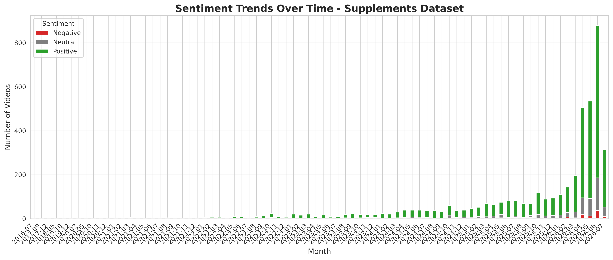

**Relative sentiment trends over time**

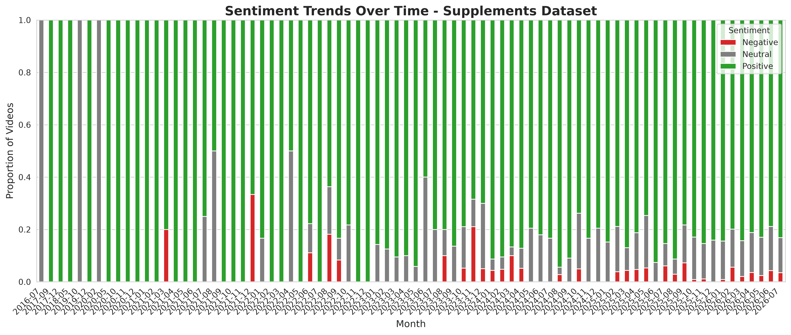

**Popularity metrics over time**

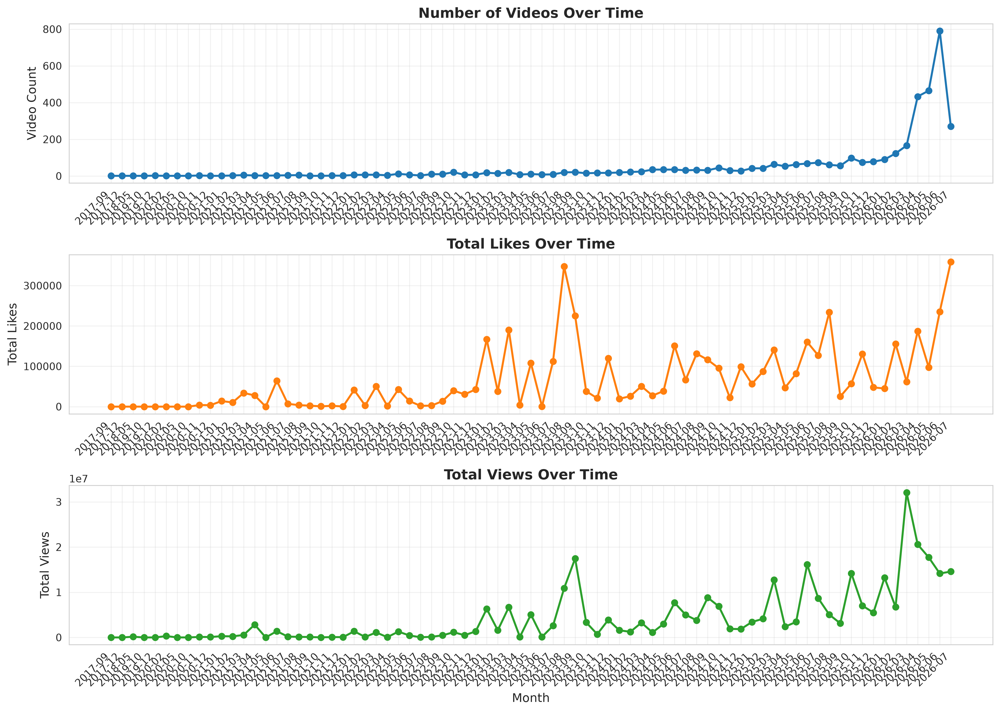

**Top 10 supplements promoted**

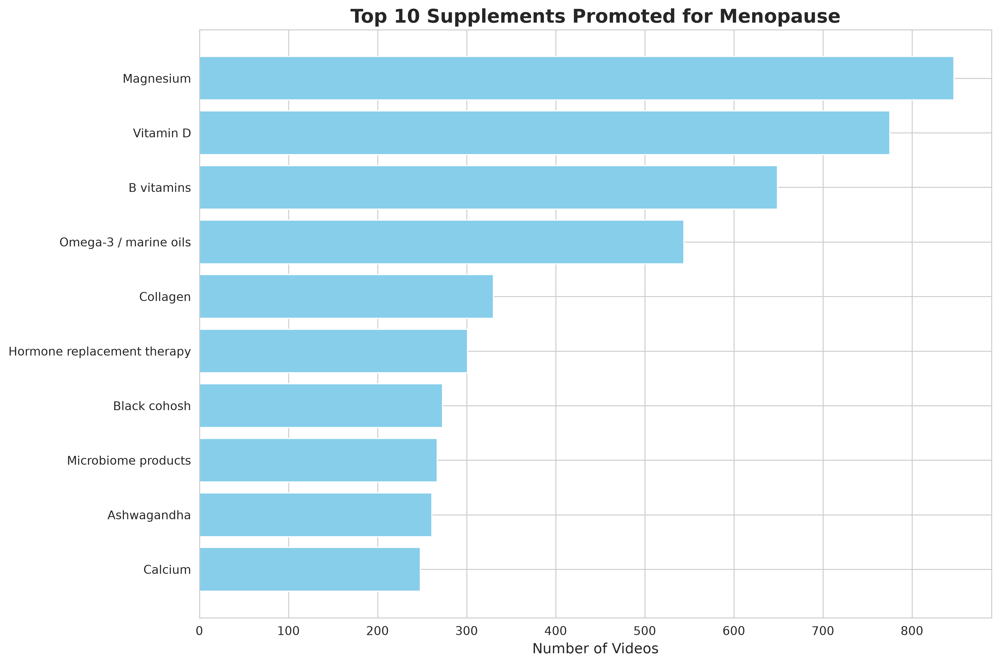

**Top 3 supplements trends over time**

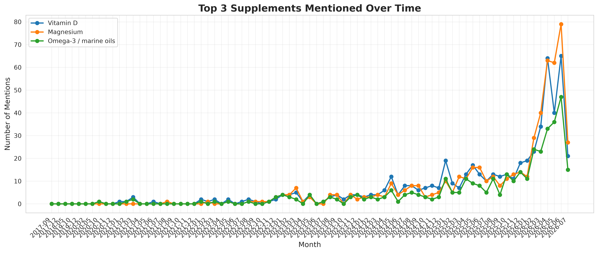

**Top 10 symptoms targeted**

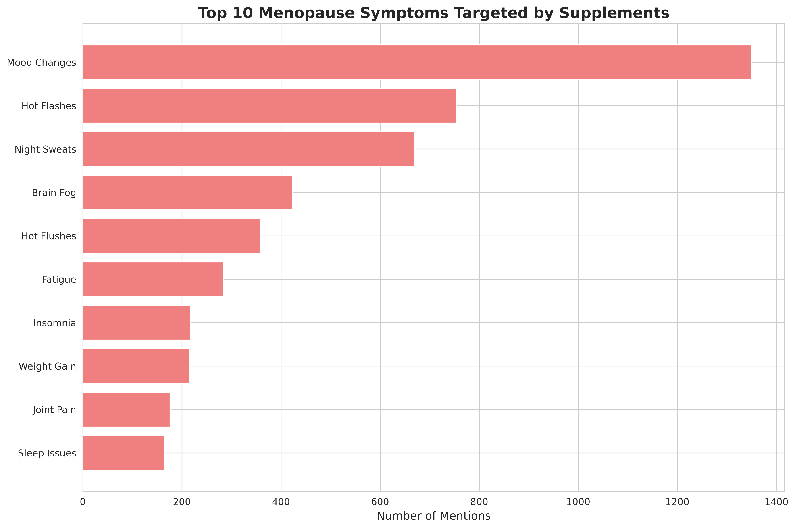


### Timeout Dataset Analysis

The timeout dataset was filtered to include only videos where `timeout=True` from YouTube, TikTok, Facebook, and Instagram (n=194 videos).

#### Key Findings

**Video Distribution by Platform:**
| extractor   |   count |       like_count |       view_count |   comment_count |
|:------------|--------:|-----------------:|-----------------:|----------------:|
| tiktok      |     111 |      6.93815e+06 |      6.96975e+07 |           75515 |
| youtube     |      43 | 933798           |      2.23285e+07 |            7239 |
| instagram   |      36 |      2.30622e+06 |      0           |           34919 |
| facebook    |       4 |      0           | 281104           |               0 |


**Sentiment Distribution:**
| sentiment   |   count |
|:------------|--------:|
| negative    |     119 |
| neutral     |      51 |
| positive    |      24 |

#### Visualizations

**Sentiment trends over time**

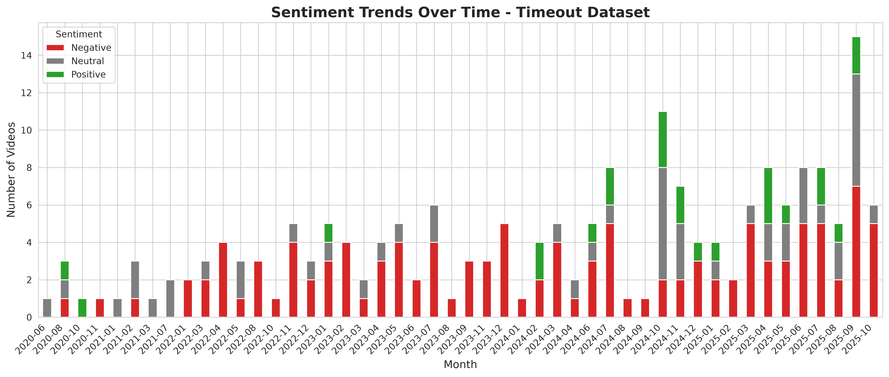

**Number of videos over time**

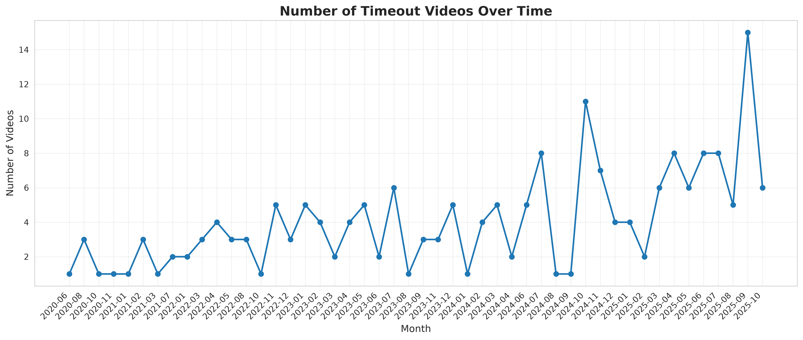


### Distress Dataset Analysis (Youth Psychological Distress, New Zealand)

The distress dataset was filtered to include only videos where `distress=True` from YouTube, TikTok, Facebook, and Instagram, with cross-platform duplicates removed (n=3326 videos). Its coding scheme is a first draft (see `get_prompt_distress` in `src/batch_LLM.py`), so these figures are indicative until the coding is validated. Search results favour recent videos, so counts over time reflect when the data was collected more than how posting has changed.

#### Key Findings

**Video Distribution by Platform:**
| extractor   |   count |   like_count |   view_count |   comment_count |
|:------------|--------:|-------------:|-------------:|----------------:|
| instagram   |    1345 |  1.35173e+07 |  0           |          217385 |
| youtube     |     805 |  2.56932e+06 |  1.43054e+08 |           61625 |
| facebook    |     713 |  0           |  2.78934e+07 |               0 |
| tiktok      |     463 |  2.35481e+07 |  2.36698e+08 |          271492 |


**Speakers:** the main speaker appears to be a young person (about 12–24) in 1146 videos (34%), is unclear in 78, and 1311 videos (39%) show a New Zealand connection.


**Who Is Communicating:**
| messaging_source                          |   videos |
|:------------------------------------------|---------:|
| young person sharing their own experience |     1237 |
| health professional                       |      947 |
| health service or charity                 |      392 |
| community or iwi organisation             |      243 |
| musician or entertainer                   |      164 |
| peer supporter or advocate                |      151 |
| government or public health campaign      |       59 |
| other                                     |       43 |


**Distress Experiences Described:**
|                         |   videos | share   |
|:------------------------|---------:|:--------|
| Stress or pressure      |     1345 | 40.4%   |
| Low mood or depression  |     1312 | 39.4%   |
| Anxiety or panic        |     1152 | 34.6%   |
| Overwhelm               |     1096 | 33.0%   |
| Loneliness or isolation |      754 | 22.7%   |
| Suicidal thoughts       |      560 | 16.8%   |
| Burnout or exhaustion   |      384 | 11.5%   |
| Grief or loss           |      327 | 9.8%    |
| Self-harm               |      235 | 7.1%    |
| Trauma                  |      188 | 5.7%    |
| Anger or irritability   |       99 | 3.0%    |


**Vocabulary Used for Distress:**
|                                         |   videos | share   |
|:----------------------------------------|---------:|:--------|
| Everyday emotional language             |     3111 | 93.5%   |
| Clinical or diagnostic terms            |      900 | 27.1%   |
| Metaphor or imagery                     |      260 | 7.8%    |
| Te reo Māori or other cultural concepts |      143 | 4.3%    |
| Slang or internet language              |       68 | 2.0%    |
| Euphemism or algospeak                  |       48 | 1.4%    |


**Top 10 Algospeak and Euphemisms** (in 221 videos; as quoted by the LLM, which sometimes includes plain words or helpline numbers):
| term             |   videos |
|:-----------------|---------:|
| unalive          |       49 |
| unaliving        |       22 |
| sewerslide       |       10 |
| 988              |        7 |
| fucking          |        4 |
| unalived         |        4 |
| suicide          |        4 |
| 1737             |        4 |
| shout            |        3 |
| mental breakdown |        3 |


**Top 10 Te Reo Māori Words** (in 385 videos):
| term           |   videos |
|:---------------|---------:|
| whānau         |      121 |
| kia ora        |       37 |
| kōrero         |       32 |
| hauora         |       30 |
| aotearoa       |       23 |
| rangatahi      |       22 |
| tamariki       |       20 |
| wairua         |       18 |
| taha hinengaro |       17 |
| kaupapa        |       17 |


**Framing of Distress:**
|                                     |   videos | share   |
|:------------------------------------|---------:|:--------|
| Individual struggle                 |     2717 | 81.7%   |
| Normal part of life                 |     1518 | 45.6%   |
| Holistic or cultural wellbeing      |     1112 | 33.4%   |
| Medical condition needing treatment |      703 | 21.1%   |
| Relational or whānau context        |      527 | 15.8%   |
| Recovery or hope                    |      338 | 10.2%   |
| Caused by external pressures        |      205 | 6.2%    |
| Stigma or shame                     |      116 | 3.5%    |


**Help-seeking:**
| help_seeking                             |   videos |
|:-----------------------------------------|---------:|
| encourages help-seeking                  |     2426 |
| not mentioned                            |      780 |
| describes the speaker's own help-seeking |       81 |
| sceptical of or discourages help-seeking |       39 |


**Sources of Support Mentioned:**
|                               |   videos | share   |
|:------------------------------|---------:|:--------|
| Friends or peers              |     1415 | 42.5%   |
| Whānau or family              |      968 | 29.1%   |
| Helpline or text service      |      954 | 28.7%   |
| Counsellor or therapist       |      857 | 25.8%   |
| GP or doctor                  |      519 | 15.6%   |
| School or university          |      230 | 6.9%    |
| Cultural or spiritual support |      207 | 6.2%    |
| Online community              |      183 | 5.5%    |
| Medication                    |      106 | 3.2%    |


**Safe Messaging** (the 600 videos discussing suicide or self-harm):
| safe_messaging               |   videos |
|:-----------------------------|---------:|
| follows guidelines           |      516 |
| partially follows guidelines |       58 |
| does not follow guidelines   |       21 |
| not applicable               |        5 |


**Self-disclosed Risk:**
| risk_disclosure                        |   videos |
|:---------------------------------------|---------:|
| no disclosure                          |     3019 |
| past suicidal thoughts or self-harm    |      158 |
| current suicidal thoughts or self-harm |      149 |

#### Visualizations

**Distress experiences described**

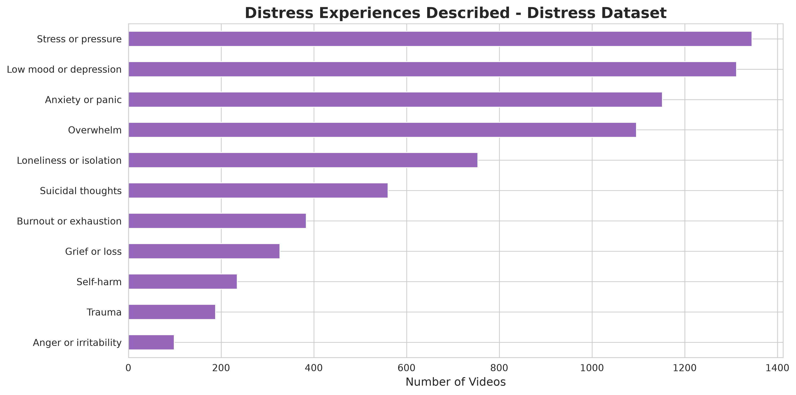

**Vocabulary used for distress**

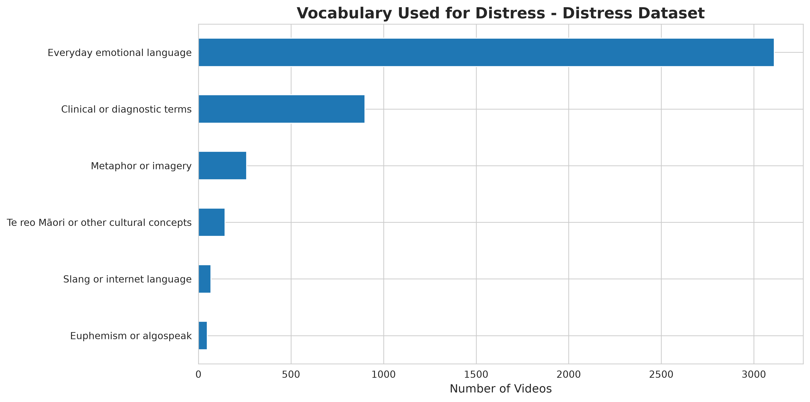

**Who is communicating**

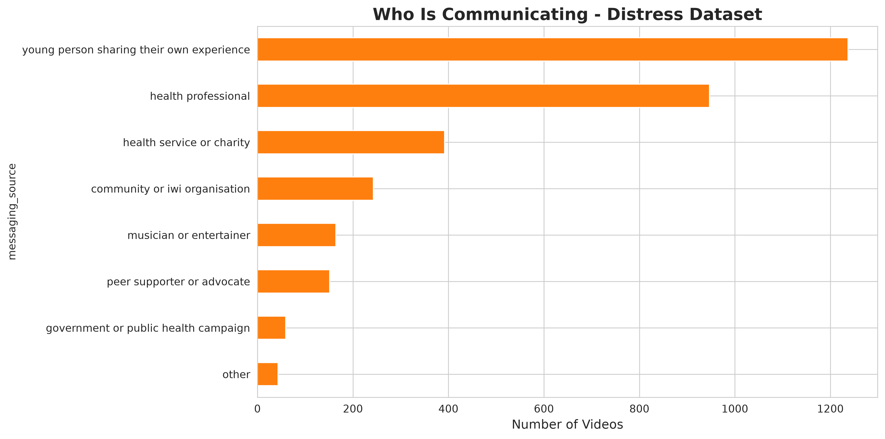

**Number of videos over time**

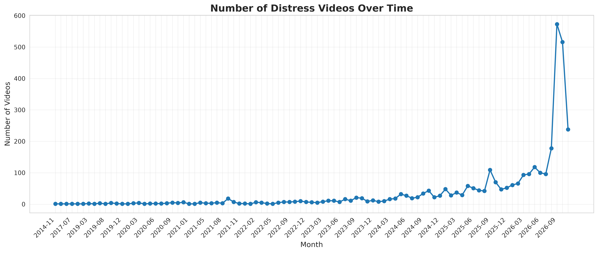
## License

See `LICENSE` file for details.
